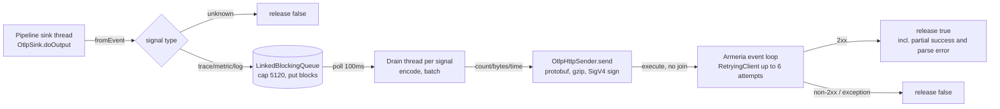

# OTLP Sink delivery model: closer to other Data Prepper sinks or to the CloudWatch Logs sink?

Scope: `otlp` (data-prepper-plugins/otlp-sink), compared with `opensearch` (bulk mode), `http` (http-sink), `s3` (s3-sink) and `cloudwatch_logs` (working tree on `cwl-sink-gap-metrics`). Paths are relative to each plugin's `src/main/java/.../sink/<name>/` unless noted. The OTLP line numbers were re-checked against the current tree.

## 1. TL;DR verdict

- **The OTLP sink belongs with the CloudWatch Logs sink, in the async family.** `doOutput` never touches the network. It enqueues to a per-signal queue (`OtlpSink.java:100-113`) and returns. A background drain thread sends the data fire-and-forget (`OtlpHttpSender.java:148-166`). opensearch, http and s3 all do the network call on the pipeline sink thread and wait for it.
- **OTLP is less broken than CWL on the main failure-semantics axes.** Its retries are bounded (`maxTotalAttempts(max_retries+1)`, `OtlpHttpSender.java:107`). Hard failures get a negative ack (`release(false)`, `OtlpHttpSender.java:164, 208`). Its intake queues are bounded (`OtlpSinkBuffer.java:84, 103`).
- **OTLP moves CWL's unbounded stage to a different place.** CWL caps concurrency (10 worker threads) and leaves its executor queue unbounded. OTLP bounds the queue but places no cap on in-flight HTTP requests. Either way, a slow endpoint grows memory and gives the pipeline no real backpressure.
- **OTLP shares two of CWL's correctness bugs.** It releases `true` without delivery in two cases: partial-success rejections and unparseable 2xx bodies (`OtlpHttpSender.java:236-242`). On shutdown it does not wait for in-flight work (`OtlpSink.java:129-132`, `OtlpSinkBuffer.java:111-114`).
- **The proposed CWL redesign is the right model for OTLP as well.** That redesign is synchronous bounded delivery on the worker, with a deadline and one terminal outcome per event. OTLP is closer to it than CWL is: retries are already bounded and negative acks already exist. What OTLP still needs is a wait on the future, a cap on in-flight requests, and a fix for the two ack-true paths.

## 2. Comparison matrix

| Axis | otlp | opensearch | http | s3 | cloudwatch_logs |
|---|---|---|---|---|---|
| 1. Dispatch model | Hybrid async. Worker does `queue.put`. Drain thread encodes, gzips, signs, then `webClient.execute()` without join (`OtlpHttpSender.java:148`) | Sync on sink thread: `BulkIngester.output` -> `BulkRetryStrategy.execute` (`OpenSearchSink.java:222-224`) | Sync on sink thread with `join()` (`HttpSinkSender.java:66-82`) | Sync. Puts started, then join all (`S3SinkService.java:152-155`) | Async. `executor.execute(Uploader)` (`CloudWatchLogsDispatcher.java:171`) |
| 2. Queue bound | 3 queues, `max(max_events*10, 2000)` = 5120 each (`OtlpSinkBuffer.java:103`). **In-flight requests unbounded** | None. One bulk request per thread, capped at `bulk_size` 5MB (`BulkIngester.java:494-505`) | One batch per request (`DefaultSinkOutputStrategy.java:89-101`) | Per group by threshold. Group count unbounded without `aggregate_threshold` (`S3GroupManager.java:32`) | Buffers bounded. **Executor queue unbounded** (`CloudWatchLogsSink.java:123`) |
| 3. Backpressure | Weak. Blocks only when a queue is full, and the drain never waits on HTTP. `isReady` ignores health (`OtlpSink.java:121-123`) | Blocks the worker during retries (`BulkRetryStrategy.java:238-243`) | Blocks every worker behind one lock (`DefaultSinkOutputStrategy.java:66-109`) | Blocks on lock plus join (`S3SinkService.java:114`) | None (`CloudWatchLogsSink.java:209-211`) |
| 4. Retry policy | Armeria RetryingClient, 6 attempts, exponential 100ms-10s with jitter, status {429,502,503,504} only (`OtlpHttpSender.java:49, 98-107`). The 3s response timeout probably caps the whole sequence (`:110-115`) | Exponential 50ms-10min, `max_retries` defaults to `Integer.MAX_VALUE` (`RetryConfiguration.java:41`) | 4 attempts, fixed 30s sleep. Transport errors not retried (`HttpSinkSender.java:78-95`) | SDK only, 5*5=25 retries (`ClientFactory.java:50`) | Infinite without a DLQ (`CloudWatchLogsSink.java:126`), plus 5 SDK retries per attempt |
| 5. Ack on success | `release(true)`. Partial success also `true` for every event (`OtlpHttpSender.java:237`) | `release(true)` per document (`BulkIngester.java:459-478`) | `release(true)` per event (`DefaultSinkOutputStrategy.java:45-61`) | `releaseEventHandles(true)` (`S3Group.java:44-54`) | `release(true)` |
| 6. Ack on failure | `release(false)` for non-2xx, exceptions and encode/gzip failures (`:164, 208, 141`). **Unparseable 2xx gets `true`** (`:242`). Synchronous throw in `send()` leaks the handle. No DLQ | DLQ, else `release(false)` (`BulkIngester.java:507-580`) | Failure pipeline, else `release(false)` (`HttpSinkService.java:69-97`) | `release(false)`, no DLQ (`BufferUtilities.java:49-73`) | **`release(true)`** without a DLQ (`CloudWatchLogsSink.java:166`) |
| 7. Flush triggers | Count, bytes or time, checked on the drain thread every 100ms poll (`OtlpSinkBuffer.java:167, 190-193`) | Size, plus time inside `doOutput` (`BulkIngester.java:389-393`) | Count, size, or time inside `doOutput` (`DefaultSinkOutputStrategy.java:68`) | Count, size or age inside `doOutput` (`ThresholdCheck.java:30-40`) | Count, size or time inside `doOutput` (`CloudWatchLogsService.java:549-575`) |
| 8. Shutdown | Drains the queue and does a final fire-and-forget send. In-flight requests not awaited, WebClient not closed (`OtlpSinkBuffer.java:111-114, 214`) | No flush of pending bulk (`BulkIngester.java:399-419`) | No flush, no override | Flushes all groups and joins (`S3Sink.java:150-163`) | No override at all |
| 9. Threading | 3 non-daemon drain threads and a shared WebClient. HTTP concurrency unbounded (`OtlpSinkBuffer.java:87-99`) | Per-thread bulk request, parallelism = pipeline workers | One lock, so 1 request in flight | One lock, parallel puts within one call | One `processLock`, 10 uploader threads |
| 10. Metrics | Records/rejected/failed/errors, http{N}xx, latency. `queueSize` and `queueCapacity` gauges collide across the 3 queues (`OtlpSinkMetrics.java:87-89`). No in-flight or retry metric | Rich per-document and retry metrics | `DefaultSinkMetrics`. `sinkEventsDropped` never incremented | Object/event success and failure counters | Rich, including queue depth and retry age (branch) |

## 3. OTLP deep dive

### Data flow

### Threading

- **Pipeline sink thread:** classifies each event and calls `queue.put`. It blocks only when the queue is full (`OtlpSinkBuffer.java:134-143`).
- **Drain threads:** one per signal type, so three, all named `otlp-sink-buffer-thread` and all non-daemon. Each does CPU work and the blocking SigV4 credential resolution (`OtlpHttpSender.java:176`), but never waits for HTTP. If a drain thread crashes, it is restarted (`OtlpSinkBuffer.java:91-95, 117-122`), but its in-progress batch is lost and those handles are never released.
- **Armeria event loops:** handle I/O, retry backoff, response handling and every `release` call. Nothing limits how many requests are outstanding.

### Retry

- **Rule:** `RetryRuleWithContent.onStatus({429,502,503,504})` with `Backoff.exponential(100, 10_000).withJitter(0.2)` and `maxTotalAttempts = max_retries + 1` (6 by default) (`OtlpHttpSender.java:98-107`).
- **Not retried:** connection errors, timeouts and 500. The rule matches on status only.
- **Timeout:** `responseTimeoutMillis = min(max(flush_timeout*2, 3000), 10000)`, 3s by default. It is set on the WebClient and there is no per-attempt timeout, so it most likely bounds the entire retried exchange. In that case the later backoffs never run, and the README's claim of about 8s of backoff does not hold.
- **Retry-After:** ignored, by design.

### Ack outcomes

| Outcome | Release | Counter | Ref |
|---|---|---|---|
| 2xx, empty body | true | recordsOut | `OtlpHttpSender.java:216-219` |
| 2xx, partialSuccess rejected>0 | **true (all)** | rejected, and recordsOut += events-rejected (can go negative) | `:228-237` |
| 2xx, body parse error | **true** | errorsCount, recordsOut | `:238-242` |
| non-2xx (incl. after retries) | false | rejected | `:197-208` |
| future exceptional (timeout, connection) | false | rejected (not failed) | `:160-165` |
| gzip returns empty | false | failed | `:138-143` |
| per-event encode exception or null | false | failed (null: none) | `OtlpSinkBuffer.java:179-183` |
| unknown signal type | false | failed | `OtlpSink.java:108-111` |
| RuntimeException in sign/build/payload | **never released** | errorsCount (thread restart) | `OtlpSinkBuffer.java:91-94, 194` |
| InterruptedException in `add()` | **never released**. The interrupt flag is re-set, so the rest of the `doOutput` loop leaks too | failed, errors | `OtlpSinkBuffer.java:137-140` |
| in flight at process exit | **never released** | none | `OtlpSink.java:129-132` |

## 4. Shared problems and avoided problems (ranked by severity)

### Problems OTLP shares with CWL

1. **High: there is no cap on in-flight work, so there is no real backpressure.** In CWL the executor queue is unbounded (`CloudWatchLogsSink.java:123`). In OTLP the in-flight futures are unbounded (`OtlpHttpSender.java:148`). The drain never waits on HTTP, so the bounded queues seldom fill. A slow endpoint grows heap while the pipeline buffer keeps checkpointing.
2. **High: some events are acked `true` without delivery.** CWL does this for every failure path when no DLQ is configured. OTLP does it only for partial success and unparseable 2xx bodies (`OtlpHttpSender.java:237, 242`). The scope is narrower, but the bug class is the same.
3. **Medium: shutdown loses acks.** CWL has no `shutdown()`. OTLP drains its queues but does not await in-flight futures or close the WebClient (`OtlpSinkBuffer.java:111-114`).
4. **Medium: some handles are never released.** In CWL this happens on an exception partway through `processLogEvents`. In OTLP it happens on a synchronous throw in `send()` and on interrupt in `add()` (`OtlpSinkBuffer.java:137-140, 194`).
5. **Low: `isReady()` ignores runtime health.** In CWL it returns only `isInitialized`. In OTLP, `running` starts true (`OtlpSinkBuffer.java:58`) and is cleared only by `stop()`.

### Problems OTLP avoids

1. **No infinite retry.** OTLP stops after `max_retries + 1` attempts and the response timeout. CWL uses `Integer.MAX_VALUE` when no DLQ is configured.
2. **Negative acks exist.** Non-2xx and exceptional completions get `release(false)`, so the source can redrive. CWL only nacks when a DLQ write fails.
3. **Bounded intake queues.** `put()` blocks, so heap is bounded before the network stage.
4. **Sends are not delayed by `doOutput`.** OTLP's time flush runs on the drain thread, so it does not depend on `doOutput` being invoked.

### Problems specific to OTLP

- **Retry coverage gaps.** The rule matches status only, so connection errors, timeouts and 500 are never retried. The 3s timeout probably cuts retries short.
- **Metric naming bugs.** The `queueSize` and `queueCapacity` gauges collide across the three queues (`OtlpSinkMetrics.java:88-89`). Exceptions are counted as rejected rather than failed. The `retriesCount` metric in the README does not exist.

## 5. What the "Data Prepper norm" actually is

The opensearch, http and s3 sinks share these patterns:

1. **They send on the sink thread and wait.** The network call runs on, or is joined by, the pipeline sink-executor thread, and the process worker waits on it indefinitely (`data-prepper-core/.../PipelineRunnerImpl.java:136-140`). Backpressure is implicit: a slow destination stalls workers, and the buffer fills.
2. **They have no sink-owned sender thread or unbounded queue.** The only buffering is one batch per thread, or per group.
3. **They send a negative ack or use a DLQ on failure.** The order is DLQ or failure pipeline first, then `release(false)`. None of them acks a failed send as `true`.
4. **Time flush runs inside `doOutput`.** It relies on core calling sinks with empty batches.
5. **Their bugs are about bounds and shutdown, not ack semantics.** opensearch retries infinitely by default and swallows interrupts. http does no shutdown flush. opensearch and http do not flush pending data at shutdown, and http never closes its client.

**Does the proposed CWL redesign match this norm?** It does, and on two points it improves on it. Synchronous bounded delivery on the worker gives implicit backpressure, the same as patterns 1 and 2. A single terminal outcome per event (true, true plus a drop metric for permanent failures, false for transient ones) gives pattern 3. Two parts of the redesign go beyond the norm. The deadline fixes the shared weakness of opensearch's infinite retry and http's 90s of sleeping. Explicit permanent/transient classification is something only opensearch partly does (`BulkRetryStrategy.java:55-65`). The redesign should also add a shutdown flush, as s3 does (`S3SinkService.java:256-290`), so that it does not inherit the opensearch and http gap.

## 6. Recommendations for OTLP (minimal, code-level)

In priority order. Each one is a small, local change.

1. **Bound in-flight requests and wait on completion.** The smallest version is to have `send()` return the `CompletableFuture`, and have `runTyped` call `.join()` on it (the drain thread is already off the pipeline thread), or hold a `Semaphore(N)` acquired before `execute` and released in `whenComplete`. With `join()`, the queue becomes the backpressure point and the existing `put()` blocking does its job. This matches the norm and the proposed CWL model.
2. **Make the partial-success ack honest** (`OtlpHttpSender.java:236-242`). OTLP gives no per-event granularity, so when `rejected > 0` the choice is between `release(false)` (redrive, with possible duplicates) and keeping `true` while adding an explicit `eventsDroppedPartialSuccess` counter. The proposed CWL rule is "permanent: true plus a drop metric", so take the second option for consistency, and clamp `recordsOut` at 0. A parse error on a 2xx should also get a drop counter, or `release(false)`.
3. **Release handles on synchronous failure in `send()`.** Wrap the work before `execute` (payload, gzip, `buildHttpRequest`/`signRequest`) in try/catch: on catch, `releaseAllEventHandle(immutableBatch, false)` and increment failed. This also covers the lost-batch-on-crash path.
4. **Fix the interrupt leak in `add()`** (`OtlpSinkBuffer.java:137-140`). Call `record.getData().getEventHandle().release(false)` in the catch.
5. **Retry exceptions as well as statuses** (`OtlpHttpSender.java:99-101`). Add `.onException()` (or `.onUnprocessed()`), and add 500 if the endpoint treats it as transient. Set `responseTimeoutMillisForEachAttempt` on the `RetryingClientBuilder` and an explicit total deadline, so that the README's backoff claim is true or the README gets corrected.
6. **Make shutdown wait** (`OtlpSinkBuffer.stop`). After `shutdownNow`, call `executor.awaitTermination(deadline)`. If recommendation 1 is in place, the final flush is then joined automatically. Close the WebClient's `ClientFactory` afterwards.
7. **Metrics.** Tag the queue gauges by signal (`queueSize.traces` and so on, `OtlpSinkMetrics.java:88-89`). Count exceptional completions as failed rather than rejected. Add an `inFlightRequests` gauge if recommendation 1 uses a semaphore.

Not recommended: adding a DLQ. The README documents at-most-once delivery, and the norm sinks only nack without one (s3). Add a DLQ when a user asks for durable fallback.
